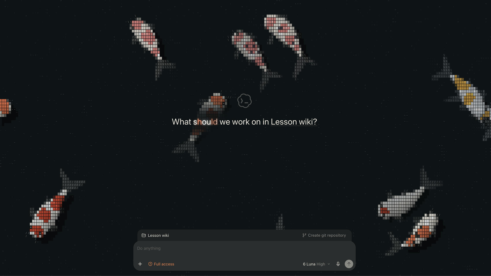
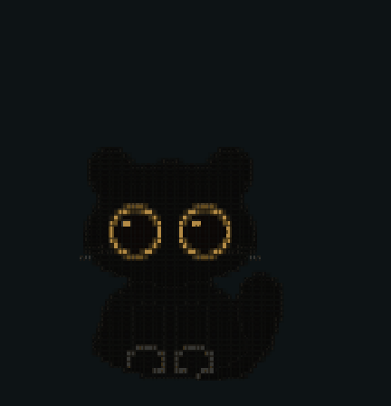

# Codex Koi

**The ASCII Koi pond behind the Codex desktop app's new-chat page, and a little black cat that keeps you company while Codex works.** Koi drawn in text characters swim under the heading, and the letters take each koi's colour as it passes beneath them. Click the water for the black cat's paw, right-click to feed the koi. The pond is gone as soon as a thread opens; the cat stays, as your Codex pet.

<p align="center">
  
</p>

<p align="center"><a href="#install"><b>▶ Install (macOS)</b></a> &nbsp;·&nbsp; <a href="#the-black-cat">The black cat pet</a> &nbsp;·&nbsp; <a href="https://pursurer.github.io/ascii-koi/">See the pond in your browser</a></p>

The pond is [ASCII Koi](https://github.com/pursurer/ascii-koi)'s own `pond.js`, byte for byte, so the koi swim, scatter and eat as they do on the ASCII Koi page.

Status: works with ChatGPT.app 26.1027 (Codex, Chromium 156) on macOS, checked 2026-11-04. It is unofficial: a Codex update can change the page and turn the pond off.

## Install

You need macOS, the ChatGPT desktop app with Codex in `/Applications/ChatGPT.app`, and Node at `/opt/homebrew/bin/node` (Homebrew). The entry app looks for this folder at `~/Projects/codex-koi`; to keep it elsewhere, change the path in `Codex Koi.applescript` before you build it.

```bash
git clone https://github.com/pursurer/codex-koi.git ~/Projects/codex-koi
```

```bash
cd ~/Projects/codex-koi && osacompile -o "$HOME/Applications/Codex Koi.app" "Codex Koi.applescript"
```

For the koi icon, copy `codex-koi.icns` over `Contents/Resources/applet.icns` in the new app and delete `Contents/Resources/Assets.car` if it is there. Then sign the app for this Mac:

```bash
codesign --force --sign - "$HOME/Applications/Codex Koi.app"
```

Quit Codex, then open **Codex Koi** from `~/Applications`.

| State of Codex | What Codex Koi does |
| --- | --- |
| Closed | Opens it with the koi |
| Already open, with or without the koi | Brings it to the front, with no prompt and no restart |

To have the koi every day, open Codex with them at login: in System Settings, go to General, then Login Items, remove ChatGPT and add `~/Applications/Codex Koi.app`. The usual Codex Dock icon then brings that same window forward. The koi go missing only when Codex is quit and opened some other way, or after Codex updates and relaunches itself; opening Codex Koi once brings them back.

To go back to plain Codex, quit it and open ChatGPT as usual. Nothing in the app bundle is changed, so nothing needs restoring.

### The matching Codex theme

`themes/ascii-koi.codex-theme.txt` is a Codex dark theme in the same black water: `#0d1315` surface, `#ebe6dc` ink, `#e8784f` accent, Geist Mono for code. In Codex, open Settings, then Appearance, choose to import a dark theme, and paste the whole line.

### The black cat

<p align="center">
  
</p>

The same black cat whose paw scoops the pond, as a Codex pet: a round black cat in character tiles with gold-ringed eyes. It breathes, blinks slowly, trots while Codex works and pounces when it is done.

```bash
mkdir -p ~/.codex/pets && cp -R pet/ascii-cat ~/.codex/pets/
```

In Codex, open Settings, go to the pets section, press Refresh and choose **ASCII Cat**.

The pet is a folder with `pet.json` and `spritesheet.webp`, a Codex v1 atlas of 1536 × 1872 px: eight columns by nine rows of 192 × 208 px cells (idle, running right, running left, waving, jumping, failed, waiting, running, review). It is drawn by the cat's own code: `pet/build/cat.js` is copied verbatim from [One Page is all you need](https://github.com/pursurer/one-page-is-all-you-need)'s page, and headless Chrome poses it frame by frame. To rebuild it (Google Chrome and Python 3 with Pillow):

```bash
cd pet/build && python3 capture.py 's=1' cat
```

```bash
python3 -c "from PIL import Image; Image.open('out/cat.png').save('out/cat.webp', lossless=True)"
```

The shipped atlas was rebuilt this way on 2026-11-04 and matched it pixel for pixel. `qa.py` makes a contact sheet and a GIF of every row.

## How it works

The approach follows [Codex-Dream-Skin](https://github.com/Fei-Away/Codex-Dream-Skin), with two differences:

- **A pipe, not a port, and no process left behind.** The launcher starts the official app with `--remote-debugging-pipe` over two FIFOs. Codex opens no TCP port; Dream Skin uses a loopback port, which any local program can reach.
  - Codex itself holds both FIFOs open read-write. Closing a plain pipe makes Codex ask to quit, but these never close.
  - So the launcher injects, stops target discovery about 8 s after start, and exits. The script stays registered for every reload of the pages it reached.
  - Windows Codex opens later get no pond until the next launch.
- **The page's own pond.** `codex-pipe.mjs` reads `pond.js` on every launch, unchanged, so the koi always match the ASCII Koi page.
- **All the pipe work happens in the first seconds.** About 4 s after start, Codex launches its computer-use helper (`SkyComputerUseService`), which inherits Codex's fds 3 and 4, the two ends of the pipe. From then on the helper can swallow bytes in either direction: small messages mostly pass, large ones (a screenshot, a screencast frame) break off and every later answer is lost. So the koi go in within about a second, nothing waits longer than 2 s for an answer, and a Codex that hands over to one already open (and quits at once) is reported instead of waited for.

`overlay.js` runs in each `app://` page. It skips the pet's overlay page and, following Dream Skin's selector contract, finds the active new-chat page as `[role="main"]:has([data-testid="home-icon"])` outside `[data-app-shell-active-page="false"]`.

On that page it puts a canvas at `z-index: -1` inside the page's main surface, which it isolates, so every native control stays above the pond. It runs `createPond` in the black water and dims the koi under the heading. When a thread opens it stops the pond and removes the canvas.

The heading keeps Codex's own font: a canvas over it draws each character again where Codex laid it out, in the heading's colour. A koi passing under a character lends it the koi's colour (across the glyph, so half a character can turn) and a soft glow, and the caustic net brightens it, as the ASCII Koi clock takes on the pond. Codex's own heading (`[data-feature="game-source"]`) stays underneath with its text made transparent, so the project name keeps its dotted underline and still opens the project menu.

The view is a little higher than the page's: the pond is simulated at `VIEW` (1.3) times the surface size and drawn back into it at the screen's own pixel density. The koi are smaller and more water shows, at no extra drawing cost.

The pond fades in over 0.9 s when the new-chat page appears, and the heading settles in after it. Both stop while the window is hidden or minimised.

## Files

| File | Role |
| --- | --- |
| `codex-pipe.mjs` | Starts Codex over the pipe and puts `pond.js` plus `overlay.js` into its app pages, now and on every reload. Shared by the launcher and the recorder |
| `launcher.mjs` | Starts Codex with the koi, waits for the windows it opens at start, then exits |
| `cdp-pipe.mjs` | DevTools protocol over the pipe: the app's fd 3 and 4, NUL-separated JSON |
| `overlay.js` | Places and runs the pond on the new-chat page |
| `pond.js` | ASCII Koi's engine, byte for byte |
| `codex-koi.sh` | `status` (koi, plain or off) and `start` |
| `Codex Koi.applescript` | Source of the entry app |
| `codex-koi.icns` | The ASCII Koi icon for the entry app |
| `record.mjs` | Promo footage. Starts Codex in English with the koi and `demo.js`, then films the window with macOS's own `screencapture -v` once Codex is in front. `--studio` only prepares Codex (koi on, sidebar hidden, no demo) for a screen recorder and a real cursor; `--restart` quits an open Codex first |
| `demo.js` | The promo take inside the page: hides the sidebar (it lists private threads) before the window is ever in front, then a drawn cursor feeds the koi on the heading, sends the cat's paw and types a prompt that is never sent. Its clicks are pointer events on whatever is under the cursor, so they take the same path as a person's |
| `probe.mjs` | Pipe check against an isolated instance (its own profile and its own `CODEX_HOME`) |
| `probe-capture.mjs` | Capture check against an isolated, signed-out instance: screencast frames, input and screenshots over the pipe. `node probe-capture.mjs <scratch dir> [Chromium flags]` |
| `themes/ascii-koi.codex-theme.txt` | The matching Codex dark theme |
| `pet/ascii-cat/` | The black cat as a Codex pet: `pet.json` and its sprite atlas |
| `pet/build/` | How the cat is drawn: the cat's code from One Page, a page that poses it, and the capture and QA scripts |
| `media/cat.gif` | The cat's preview above |

## Develop

Keep `pond.js` identical to ASCII Koi's. With both repositories side by side:

```bash
cp ../ascii-koi/pond.js pond.js
```

`KOI_EVAL='<expression>' node launcher.mjs` logs the expression's value from each page 6.5 s after injection, for example to read the DOM of the home page. The launcher's log is `~/Library/Logs/codex-koi.log`.

`record.mjs` and `launcher.mjs` both start Codex themselves. A take with the built-in demo (add `--restart` to quit an open Codex first; leave Codex in front, pointer off the window, until `take done`):

```bash
KOI_OUT=/tmp/codex-koi-take node record.mjs --restart
```

For a screen recorder such as Screen Studio, where you move the real cursor yourself:

```bash
KOI_OUT=/tmp/codex-koi-take node record.mjs --studio --restart
```

After editing the AppleScript, rebuild the entry app as in Install. To change only its script and keep the app's icon and identity, compile into the existing bundle and sign again:

```bash
osacompile -o "$HOME/Applications/Codex Koi.app/Contents/Resources/Scripts/main.scpt" "Codex Koi.applescript"
```

<!-- family:start -->
## The ASCII Koi family

One design, and the two places it lives. Koi drawn in text characters, letters that take a koi's colours as it swims under them, a black cat in character tiles, and black water (`#0d1315` water, `#ebe6dc` ink, `#e8784f` accent).

| Project | What it is |
|---|---|
| [ASCII Koi](https://github.com/pursurer/ascii-koi) | **The design.** The pond itself: your new tab, under a clock made of the same characters. Its `pond.js` is the engine both apps run, byte for byte |
| **Codex Koi** (this repository) | **In Codex.** The pond behind the Codex desktop app's new-chat page, and the black cat as your Codex pet |
| [One Page is all you need](https://github.com/pursurer/one-page-is-all-you-need) | **In your morning.** A one-page briefing that an n8n agent writes every day, opening on the pond. Where the koi and the cat began |

Every repository in the family has the topic [`ascii-koi`](https://github.com/topics/ascii-koi).
<!-- family:end -->

## License

MIT.
